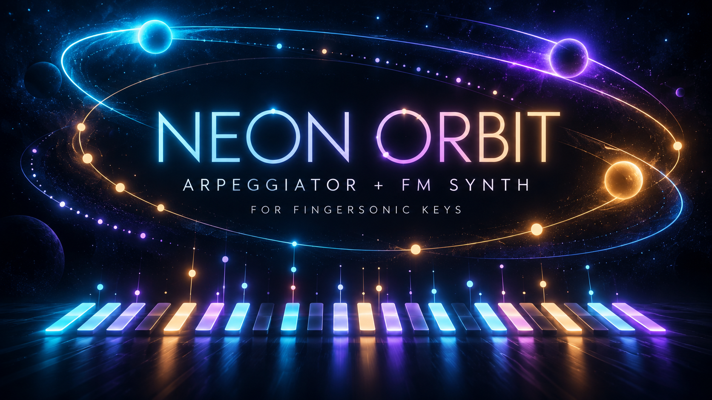

# Neon Orbit

### Arpeggiator + FM Synth for Fingersonic Keys



Hold a few notes. Let them orbit. Neon Orbit turns Fingersonic Keys into a self-contained electronic instrument: ten rhythmic patterns, ten FM voices, a wide octave range and light trails that follow each generated note. Turn the knobs while you play to move from glassy plucks to metallic bells, rubbery bass and floating synth textures.

**MIDI preview: v0.2.0-beta.1 adds bidirectional USB MIDI and BLE MIDI. The ESP32-S3 build and host-test results are recorded in [VALIDATION.md](VALIDATION.md); the new USB/BLE integration still requires on-device interoperability testing.** The original v0.1.0 instrument was device-tested by the maintainer on October 21, 2026. Read the recovery section before installing, especially on devices produced before January 1, 2027.

[Download MIDI preview firmware](https://github.com/lastness09/fingersonic-keys-neon-orbit/releases/tag/v0.2.0-beta.1) · [Stable v0.1.0 community page](https://fingersonic.com/firmware/3/) · [Developer guide](https://github.com/lastness09/fingersonic-keys-devkit) · [Validation](VALIDATION.md) · [Changelog](CHANGELOG.md) · [MIT license](LICENSE)

## Watch the hardware demo

[](https://www.youtube.com/shorts/pRCk6zMpI8U)

**[Watch Neon Orbit on Fingersonic Keys - YouTube Short](https://www.youtube.com/shorts/pRCk6zMpI8U)**. See and hear the original v0.1.0 instrument in action. This video does not validate the new MIDI preview. The video opens on YouTube; the downloadable WAV is a separate host-rendered preview.

## Develop your own version

Start with the [Fingersonic Keys Developer Guide](https://github.com/lastness09/fingersonic-keys-devkit) for the GPIO mapping, matrix/contact behavior, App0/App1 layout and recovery requirements. Use this repository as the complete MIT-licensed arpeggiator/synth example, with its own pinned Arduino toolchain, source, tests and build instructions below. The guide links back to this example.

[All Developer Kits](https://fingersonic.com/developers/#open-source-examples) · [Keys hardware contract](https://github.com/lastness09/fingersonic-keys-devkit/blob/main/HARDWARE_CONTRACT.md) · [Neon Orbit firmware page](https://fingersonic.com/firmware/3/)

## USB MIDI and BLE MIDI

Neon Orbit is now both a self-contained instrument and a MIDI arpeggiator. The physical keyboard, USB MIDI input and BLE MIDI input can play together. Incoming notes become roots for the selected pattern; the generated arpeggio drives the internal FM synth and is sent to both connected MIDI outputs on **channel 1**. Output is the generated arpeggio, rather than a duplicate raw-key stream. The local volume knob controls the internal synth and does not change outgoing note velocity.

### Connect over USB

1. Install the MIDI preview application BIN through the existing App1 uploader, following the recovery instructions below.
2. Connect the instrument's native USB port to a computer or compatible USB host using a data-capable cable.
3. Select **Neon Orbit / Neon Orbit MIDI** in your DAW or MIDI monitor. Enable it as an input to record the generated notes, or route a host MIDI track to it to supply arpeggiator roots.
4. Hold some physical keys, or send Note On/Off messages from the host. The local synth and connected MIDI output follow the selected pattern, tempo and range.

The firmware uses class-compliant **USB MIDI 1.0 device mode with TinyUSB**, one virtual cable (cable 0), and no USB serial/CDC interface. It does not act as a USB host for another USB keyboard and does not stream USB audio. The old Hardware CDC/JTAG USB build setting cannot provide this MIDI interface; use the updated build script.

### Connect over Bluetooth Low Energy

1. Open a BLE-MIDI-capable application's MIDI/Bluetooth connection panel.
2. Find **Neon Orbit**, connect, and enable its MIDI notification/input port. This is a BLE MIDI peripheral, rather than a Bluetooth audio speaker.
3. Select its MIDI ports in the application. One BLE central can connect at a time; USB can remain connected simultaneously. Device discovery and any required BLE-MIDI support depend on the host operating system and application.

The standard BLE-MIDI service is `03b80e5a-ede8-4b33-a751-6ce34ec4c700`; its read/write/notify characteristic is `7772e5db-3868-4112-a1a9-f2669d106bf3`. The advertised name is included in the scan response. Notifications are sent only after the client subscribes. No audio is sent over BLE.

### MIDI input and controls

| Message | Behavior |
| --- | --- |
| Note On/Off, channels 1-16 | Add/release roots in A0-C8 (MIDI notes 21-108); velocity-zero Note On means Note Off |
| CC64 sustain, per input/channel | Hold released MIDI roots until the pedal is released; physical keys have no sustain pedal state |
| CC7 volume, any input channel | Set internal synth volume to 0-127 and synchronize the right-knob volume value |
| Program Change 0-9 | Select the ten internal FM presets; some hosts display these as programs 1-10 |
| CC123 All Notes Off | Release that input/channel's keys; an active sustain pedal still holds them |
| CC120 All Sound Off | Clear that input/channel's roots, silence internal synthesis tails and request output panic; other held input roots can generate subsequent notes |
| CC121 Reset All Controllers | Release that input/channel's sustain latch while retaining notes that are still held |
| Unsupported channel messages, SysEx and MIDI Clock/Start/Stop | Do not control this release; tempo remains set by the left knob |

Pitch bend, aftertouch, MPE, MIDI 2.0, external clock synchronization and raw MIDI Thru are not implemented. MIDI input is processed on arrival; BLE sender timestamps are decoded as framing and do not schedule future playback. Generated MIDI is sent from bounded queues outside the audio task, so USB/BLE timing is subject to host scheduling and connection latency.

Notes and sustain are owned separately by each USB/BLE channel and the physical keyboard. Releasing a note on one input does not release another input's copy of the same pitch. Disconnecting a transport releases only its roots and pedal latches. A new output connection starts with All Sound Off/All Notes Off and receives future arpeggiator onsets, rather than replaying an old queue. Queue overflow or an output backlog older than 100 ms triggers cleanup; a busy output retries messages in order instead of dropping a Note Off. Recovery entry also requests an explicit Note Off and channel-1 panic before switching to App1; delivery is necessarily best effort if a host has stopped accepting data.

Keep DAW routing from sending Neon Orbit's generated output straight back into the same input: there is no automatic MIDI Thru, but such host routing would still create an arpeggiator feedback loop. Release all physical keys, MIDI notes and sustain pedals to stop new notes.

## Make a small keyboard feel expansive

- **USB MIDI + BLE MIDI:** receive notes, sustain, volume and program changes; send the generated arpeggio on channel 1.
- **Ten rhythm patterns:** straight, syncopated, Euclidean, three-note bursts and randomized motion.
- **Ten FM sounds:** plucks, kalimba, bells, bass, koto, marimba and synth textures, generated directly on the device.
- **30-300 BPM:** press and turn the left encoder for tempo changes in 2 BPM increments; default 120 BPM.
- **1-8 octave-range settings:** begin with the physical keys, then expand the candidate pitches across A0-C8. The default two-range setting makes a single C3 alternate between C3 and C4.
- **Velocity-sensitive playing:** dual-contact key scanning drives synthesis and rhythmic accents.
- **Note-reactive lighting:** a bright sounding note, a colored same-name octave partner, traveling trails and short light ripples. Display intensity responds to the generated audio amplitude.
- **Eight synthesis slots:** decaying tails overlap for a fuller sound, with smoothed volume, stereo cross-echo and soft limiting.
- **No SF2 or PSRAM requirement:** this is an algorithmic synthesizer. It does not mount LittleFS or replace the existing sound bank.

The arpeggiator produces one gated note at a time; the eight synthesis slots allow release tails to overlap. The 88-note range describes available candidate pitches, not 88 simultaneous voices or 88 physical keys.

## Quick performance guide

1. Start with a low listening level. Hold one or more keys to start the arpeggiator.
2. Turn the left knob to choose a rhythm. Hold it while turning to change tempo.
3. Turn the right knob to choose a sound. Click it to switch to volume mode, then turn to adjust the level; click again to return to sound selection.
4. Hold the right knob while turning to adjust the octave range. Release the physical keys and any MIDI notes/sustain pedals to stop new notes; short release tails and echo may remain.

There is no physical-key latch: the arpeggiator follows active physical and MIDI roots, including MIDI sustain. Parameters reset at power-on; this release does not save settings.

## Complete controls

| Gesture | Action |
| --- | --- |
| Hold one or more keyboard keys | Run the selected pattern using those notes and the selected octave range |
| Release all keyboard keys | Release the physical roots; MIDI and sustained roots continue until their own releases |
| Turn left knob | Cycle through the ten patterns |
| Hold left knob and turn | Change tempo by 2 BPM per detent, from 30 to 300 BPM |
| Short-click right knob | Toggle sound-selection and volume modes; starts in sound mode |
| Turn right knob in sound mode | Cycle through the ten FM presets |
| Turn right knob in volume mode | Change volume by 2, on a 0-127 scale |
| Hold right knob and turn | Change octave-range setting from 1 to 8; retains the previous sound/volume mode after release |
| Keep the leftmost key, Key0, held and short-click the left knob five times within one second | Show amber lights, then select and restart into the existing App1 uploader |

Holding/turning the left knob to change tempo is not counted as a recovery click. Releasing Key0, turning the left knob or making a long press cancels the recovery-click sequence. Holding/turning the right knob changes range without toggling its sound/volume mode on release. A standalone left-knob click has no additional action.

Changing pattern restarts its 16-step cycle. Tempo and octave-range changes preserve beat phase. The range expansion retains the original notes, shifts the octave window downward near C8, merges duplicate pitches and uses the greatest contributing key velocity. With all 12 pitch classes held, range 8 can span all 88 candidate notes from A0 to C8.

## Ten patterns

Each row is a 4/4 bar of sixteen sixteenth-note positions, grouped by beat. `x` is a trigger and `.` is a rest. Each pattern has its own gate length; beat accents modify the held-note velocity.

| # | Pattern | Rhythm | Note order |
| --- | --- | --- | --- |
| 1 | Neon Up | `x.x. x.x. x.x. x.x.` | Ascending eighth notes |
| 2 | Down Drive | `xxxx xxxx xxxx xxxx` | Descending sixteenth notes |
| 3 | Mirror Sync | `x..x ..x. x..x ..x.` | Up/down bounce with syncopation |
| 4 | Wide Steps | `x.x. ..x. x.x. ..x.` | Low, high, next-low, next-high |
| 5 | Tresillo | `x... ..x. .... x...` | Ascending 6+6+4 spacing |
| 6 | Offbeat | `..x. ..x. ..x. ..x.` | Descending offbeats; the first step is a rest |
| 7 | Euclid 5 | `x..x ..x. .x.. x...` | Five triggers per bar with bouncing pitch order |
| 8 | Euclid 7 | `x.x. x.x. x..x .x..` | Seven triggers per bar, alternating outside pitches |
| 9 | Triple Burst | `xxx. xxx. xxx. xxx.` | Three repeated sixteenth notes, then a rest and next pitch |
| 10 | Random Orbit | `xx.. x.xx x..x x.x.` | Random selection; avoids adjacent repeats with multiple candidates |

## Ten FM presets

| # | Preset | Character |
| --- | --- | --- |
| 1 | Glass Pluck | Clear, bright glass-like pluck |
| 2 | Neon Kalimba | Electronic thumb-piano sparkle |
| 3 | Copper Bell | Metallic bell with non-integer modulation ratios |
| 4 | Rubber Bass | Elastic low end with a sub-octave component |
| 5 | Acid Spark | Short, feedback-colored synth bite |
| 6 | Digital Koto | Fast-decaying electronic string pluck |
| 7 | Crystal Marimba | Crisp, percussive mallet tone |
| 8 | Velvet Synth | Softer synthesis with a longer decay |
| 9 | Laser Droplet | Bright, liquid electronic accent |
| 10 | Dream Harp | Gentle harp-like sparkle and a longer tail |

The engine combines two modulation signals, a carrier harmonic and optional sub-octave energy. Preset changes apply to new notes; active voices retain their previous envelope. Audio is 44.1 kHz, signed 16-bit stereo over the documented Keys I2S pins.

## Lights that follow the sound

Held keys have a dim base glow. Each synthesized onset creates a bright primary note and a more saturated same-name note in the other physical octave. Expanded notes outside the physical 24-key range fold back to appropriate pitch-class positions. A moving trail links note positions and a short ripple spreads to neighboring LEDs.

Parameter feedback uses cyan for pattern selection, purple for sound selection, amber for tempo, green for volume and blue for octave range. Pattern and preset numbers use two LEDs each among the first 20; range uses three LEDs per setting. Feedback normally clears after about 0.9 seconds. Bright playing cues take priority. LEDs update at 50 fps outside the audio task.

## Compatibility and boundaries

This firmware is for **Fingersonic Keys**, ESP32-S3, 16 MB flash, existing App0/App1 partition layout. It uses internal RAM with PSRAM disabled. It is not a Guitar or Beats firmware.

This release intentionally focuses on arpeggiation and direct synthesis. It does not provide loops, the official chord mode, transposition, pitch bend or official app control. There is no sample playback and no SF2 installation step. If you extend it into a sampler, keep banks in **SF2**: the installed App1 uploader supports only executable BIN firmware and SF2 banks.

Power, charging and battery-level management remain handled by the independent hardware chip. The application does not control charging or read battery state. It does not mount or format LittleFS, change the sound bank or write official instrument settings. Application parameters are not saved. OTA boot selection is written when you explicitly invoke App1 recovery; the ESP32/Bluetooth stack may also maintain its own PHY, identity or bond state in NVS. BLE startup first checks NVS initialization and skips BLE on an error, before the library can take its erase-on-error path. The application never erases NVS to repair Bluetooth initialization.

## Installation and return to the official instrument

1. Obtain `neon-orbit-v0.2.0-beta.1.bin` from the release. Check its SHA-256 against the release manifest. Upload the **application BIN only**, not a ZIP, ELF, bootloader, partition table or merged system image.
2. Enter the existing App1 uploader. With the official Keys firmware running, hold Key0 and quickly press the left knob five times. Devices produced on or after January 1, 2027 with the recovery bootloader also support holding the right knob while powering on for at least 0.5 seconds.
3. Follow the official updater's hotspot connection instructions. With the host connected to the device, send the BIN to App1's existing upload interface. For example, on Windows:

```powershell
curl.exe --fail --show-error -F "file=@C:\path\to\neon-orbit-v0.2.0-beta.1.bin" http://192.168.4.1/upload
```

4. Keep power stable, let the upload finish and allow the instrument to restart. Do not run the Arduino IDE's normal full-device upload or change eFuses.
5. To leave Neon Orbit, keep Key0 held and short-click the left knob five times within one second. Amber indicates pending App1 entry. If App1 is missing, its layout is wrong or selection fails, red feedback appears and the application remains running.
6. Use the [official Keys updater](https://update.fingersonic.cn/FingersonicUploader/) from App1 to restore the official App0. The original sound bank is preserved by Neon Orbit, so a separate sound-bank restoration is normally unnecessary unless you changed it elsewhere.

**Recovery limitation:** on devices produced before January 1, 2027, App1 entry depends on a working App0. If experimental firmware cannot boot, hangs or loses its recovery gesture, normal user recovery may be unavailable and the device may be bricked. Install at your own risk. The newer right-knob gesture requires the recovery bootloader and valid App1; it is not ROM download mode and cannot repair damaged system partitions.

## Build the open-source project

Clone into a folder named `NeonOrbit`, matching `NeonOrbit.ino`:

```text
git clone https://github.com/lastness09/fingersonic-keys-neon-orbit.git NeonOrbit
cd NeonOrbit
```

For GitHub's ZIP download, extract the project and rename the sketch folder to `NeonOrbit` before opening it in Arduino IDE. Install these pinned dependencies using Arduino CLI or the IDE's board/library manager:

```text
arduino-cli config add board_manager.additional_urls https://espressif.github.io/arduino-esp32/package_esp32_index.json
arduino-cli core update-index
arduino-cli core install esp32:esp32@3.3.2
arduino-cli lib install "Adafruit NeoPixel@1.15.1"
arduino-cli lib install "NimBLE-Arduino@2.3.1"
```

Build in PowerShell:

```powershell
.\build.ps1 -ArduinoCli 'C:\path\to\arduino-cli.exe'
```

The script compiles only, checks ESP32-S3 chip ID and the 2 MiB App0 limit, and writes `build/neon-orbit-v0.2.0-beta.1.bin` plus `build/manifest.json`. Board settings: ESP32S3 Dev Module, 240 MHz, 16 MB flash, DIO 80 MHz, custom partition table, PSRAM disabled, USB-OTG (TinyUSB), USB CDC On Boot disabled. NimBLE-Arduino 2.3.1 supplies BLE; no external USB-MIDI or BLE-MIDI transport library is required. The build script checks the pinned board and library versions. `partitions.csv` is a local build reference; never upload its generated system image through the App0 workflow.

## Tests and architecture

`ArpEngine` schedules note/gate events in the audio sample clock. `FmSynth` renders voices and echo. `Controls` handles encoders, buttons, contacts and the recovery gesture. `PerformanceLeds` renders queued note cues outside the audio task. `ArpFirmware` connects the matrix and controls to the audio task using fixed queues. `MidiInput` merges physical and MIDI note ownership, `MidiProtocol` validates USB/BLE framing, `MidiOutput` handles output retries/panic, and `MidiTransport` connects TinyUSB and NimBLE without calling either stack from the audio task. `App1Recovery` checks the dedicated uploader partition and the OTA result before restarting.

The host tests exercise the real portable engine, synth, controls, recovery selector, LED renderer and MIDI protocol/ownership/output queues with mocked device OTA calls. They do not replace USB enumeration or BLE interoperability testing on an instrument. On Windows with the documented LLVM tools:

```text
python tests/test_core.py --llvm-bin C:/path/to/llvm/bin --preview build/neon-orbit-preview.wav -v
```

The runner currently targets Windows and needs `clang++.exe`, `llvm-dlltool.exe`, and LLVM's linker. It is not a cross-platform test runner. See [VALIDATION.md](VALIDATION.md) for checks performed and required hardware acceptance tests. The 25-second software preview demonstrates ten sound/pattern combinations and is not a recording of the actual speaker.

## License and scope

The source in this repository is the independent Neon Orbit community project, originally developed as `main2_ARP`, released under the [MIT license](LICENSE). Third-party Arduino, ESP-IDF, NimBLE and NeoPixel dependencies retain their respective licenses and are installed separately; see [third-party notices](THIRD_PARTY_NOTICES.md). This repository does not publish the official Fingersonic Keys application, the App1 uploader or factory bootloader source.
